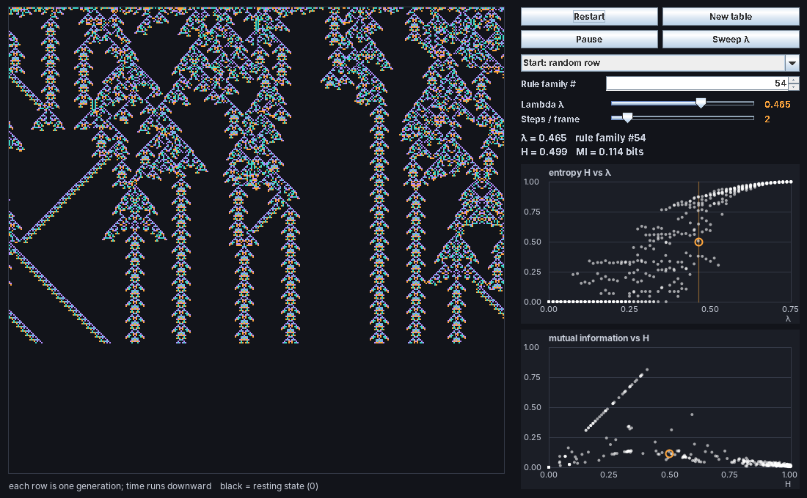
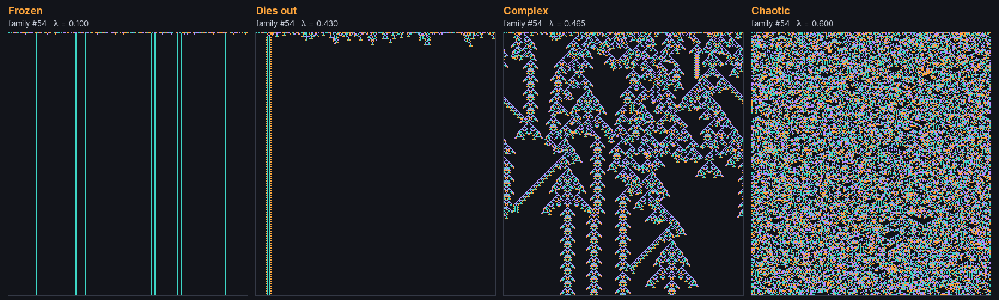
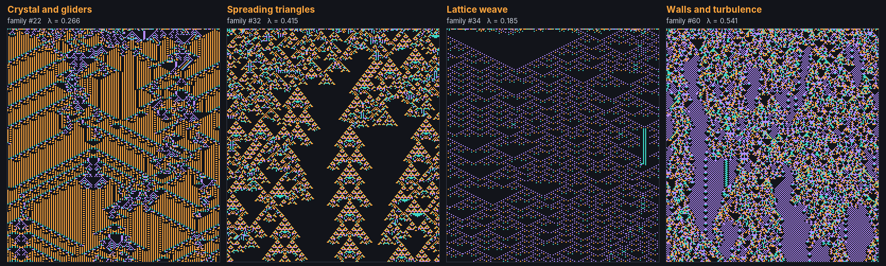
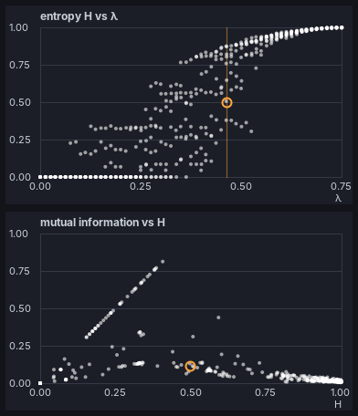

# Langton Lab

**Explore the edge of chaos.**

Langton Lab is a small desktop program that lets you turn a single dial and watch a simple world move from death, through frozen order, into a narrow band where complex, life-like structures appear, and finally into boiling chaos. It recreates the experiment behind one of the most famous ideas in the science of complexity: Chris Langton's **"edge of chaos"**.



---

## The idea in one paragraph

In 1990 the computer scientist **Chris Langton**, one of the founders of the field of *artificial life*, asked a bold question: where in the universe of possible rules does *computation*, the ability to store, transmit and process information, become possible? He found that the answer lies neither in rigid order nor in randomness, but in a thin borderland between them. Too much order and nothing can happen. Too much disorder and nothing can last. Only at the edge, he argued, can a system both remember and change. Langton Lab lets you go looking for that edge yourself.

---

## What you're looking at

The lab simulates a **cellular automaton**: about the simplest kind of world imaginable.

- The world is a single **row of cells**, like beads on a necklace (the ends join up into a loop).
- Each cell is in one of **four states**, shown as black, orange, teal and violet. Black is the **resting state**: think of it as empty space.
- Time moves in ticks. At each tick, every cell looks at itself and its two nearest neighbours on either side, and consults a **rule book** to decide what colour it becomes next.
- Each new generation is drawn as a row **below** the last, so the picture is a record of the whole history of the world, with **time running down the screen**.

That's all. There is no physics, no goals, no design: just a rule book, applied over and over. Yet out of this come structures that travel, collide, reproduce patterns and interact.

---

## Lambda: the one dial

A rule book has 1,024 entries, one for every possible pattern of five neighbouring cells. Langton realised he could describe any rule book with one simple number, which he called **lambda (λ)**:

> **λ is the fraction of rules that lead to an "active" (non-black) state.**

- **λ = 0**: every rule says "go black". Everything dies instantly.
- **λ = 0.75**: the rules are completely random, with every colour equally likely. The result is pure noise.
- **In between**: something much more interesting.

As you slide λ upward, the lab switches rules on one at a time in a fixed order (Langton called this the *table walk-through*). So you are not jumping between unrelated worlds; you are gradually changing a single world and watching how its character changes.



The picture above shows the same rule family at four settings of λ:

1. **Frozen.** Almost everything dies, leaving a few motionless stripes.
2. **Dies out.** A brief flurry of activity at the start, then silence.
3. **Complex.** The magic zone. Triangles erupt and collapse, signals slide diagonally across the world, stable "ladders" form where structures collide, and the activity lasts for hundreds of generations.
4. **Chaotic.** Every cell flickers unpredictably. Plenty is happening, but nothing lasts long enough to *mean* anything.

Notice how close the complex and chaotic panels are on the dial. The difference between λ = 0.465 and λ = 0.60 is a handful of rules out of a thousand. The edge of chaos is a narrow place.

---

## Getting started

You need **Java** (version 11 or newer). It's free.

1. **Check whether you already have Java.** Open *Terminal* (Mac) or *Command Prompt* (Windows) and type:

   ```
   java -version
   ```

   If you see a version number of 11 or higher, you're ready. If not, download Java from [adoptium.net](https://adoptium.net) and install it like any other program.

2. **Download Langton Lab.** On this page, click the green **Code** button, choose **Download ZIP**, and unzip it.

3. **Run it.** In Terminal, go to the unzipped folder and type:

   ```
   java LangtonLab.java
   ```

   A window opens and the world starts running. There is nothing else to install.

---

## How to use it

### The controls

| Control | What it does |
|---|---|
| **Lambda λ** | The main dial: the fraction of rules that lead to activity. Move it slowly near the interesting zone: a change of 0.005 can be the difference between death and life. |
| **Rule family #** | Which rule family you're exploring. Each number is a different, but always reproducible, rule book. Type a number to jump straight to it. |
| **New table** | Moves on to the next rule family. |
| **Restart** | Starts the world again from a fresh random row, keeping the same rule. |
| **Start** menu | Begin from a fully random row, or from a small random block in the middle of an empty world (good for watching activity spread or fade). |
| **Steps / frame** | Simulation speed. |
| **Pause / Run** | Freezes the picture so you can study it. |
| **Sweep λ** | Runs Langton's experiment (see below). |

### Things to try

1. **Start with the default.** The lab opens on rule family **#54** at **λ = 0.465**, a rule right on the edge. Watch the structures interact. Then press **Restart** a few times: the details change every time, but the character stays the same.
2. **Watch it settle.** Leave it running and, eventually, the complexity usually calms down into simple repeating columns. This isn't a fault. Langton found that rules near the edge have extremely long **transients**, periods of rich activity before the world settles. The closer to the edge, the longer they last.
3. **Find the edge by hand.** Drag λ down to about 0.10, then creep it upward. Watch for the moment the world stops dying and starts to live.
4. **Explore other families.** Every family has its own edge, at its own value of λ. Here are some favourites to type into the **Rule family #** box:



| Family | λ | What you'll see |
|---|---|---|
| 54 | 0.465 | Erupting triangles, diagonal signals and stable ladders |
| 22 | 0.266 | A crystal-like background crossed by gliders and defects |
| 32 | 0.415 | Spreading triangles that compete for space |
| 34 | 0.185 | A delicate woven lattice with travelling patterns |
| 60 | 0.541 | Solid walls holding back turbulence |

Found a beauty of your own? Note down the family number and λ, and anyone can reproduce it exactly.

---

## Langton's experiment: the Sweep

Langton didn't just look at pictures. He wanted to *measure* the edge. He used two numbers, which the lab calculates live and shows in the readout:

- **Entropy (H)** measures **variety**: how evenly the cells are spread across the four colours. A dead world has H = 0. Pure noise has H = 1.
- **Mutual information (MI)** measures **memory**: how much knowing a cell's colour now tells you about its colour at the next tick.

Press **Sweep λ** and the lab runs Langton's experiment. It takes eight different rule families, walks each one from λ = 0 to λ = 0.75, and measures H and MI at every step. The results appear as white dots on the two graphs. An **orange ring** marks the world you're currently running.



**Top graph: variety against λ.** At low λ the dots sit on the floor: dead worlds. At high λ they crowd the ceiling: chaos. In between is a wide, scattered band where the worlds are neither dead nor random. Langton called this the **transition region**, and it is where the complex rules live.

**Bottom graph: memory against variety.** This is the heart of Langton's argument, and it shows three kinds of world:

- **The diagonal line** (upper left): frozen worlds. Their memory is perfect, because nothing ever changes, but nothing is happening either.
- **The floor on the right**: chaotic worlds. Lots of variety, but almost no memory. Each moment forgets the last.
- **The scattered region between**: worlds that combine some variety with some memory.

Computation needs both: the ability to *store* information (memory) and the ability to *change* it (variety). Langton's insight was that these two needs pull in opposite directions, and the only place both can be satisfied is the narrow region between order and chaos.

---

## A note of scientific caution

Langton's edge-of-chaos idea was enormously influential, but it has also been debated. λ only predicts behaviour **on average**: two rules with the same λ can behave completely differently, which you'll see for yourself as you explore different families. In 1993 Melanie Mitchell, Peter Hraber and James Crutchfield re-ran an influential experiment that had seemed to support the idea, and found the evidence weaker than claimed. Today the edge of chaos is best seen as a powerful and suggestive principle rather than a precise law. Langton Lab lets you judge for yourself.

---

## Companion project

Langton Lab is a companion to **[Kuramoto Lab](https://github.com/RDMachinery/KuramotoLab)**, which explores how thousands of independent oscillators fall into synchrony. Both labs turn one dial through a transition between order and disorder, and both find their most interesting behaviour right at the boundary.

---

## Technical note

Langton Lab is a single Java file with no external libraries. It simulates a one-dimensional cellular automaton with K = 4 states and a neighbourhood of radius 2 (five cells), giving rule tables of 4⁵ = 1,024 entries, on a ring of 340 cells. Rules are reflection-symmetric, and the all-resting neighbourhood always stays at rest. λ is varied using Langton's table walk-through: each rule family fixes a random order in which entries become non-quiescent. H is the single-cell Shannon entropy normalised by log₂K, and MI is the mutual information between a cell's state and its own state one step later, in bits. The sweep uses eight rule families, 61 values of λ, 300 transient steps and 200 measured steps on a 200-cell ring.

Reference: C. G. Langton, "Computation at the Edge of Chaos: Phase Transitions and Emergent Computation", *Physica D* 42 (1990), 12–37.

---

## Author

Created by **Mario Gianota** ([RDMachinery](https://github.com/RDMachinery)).
